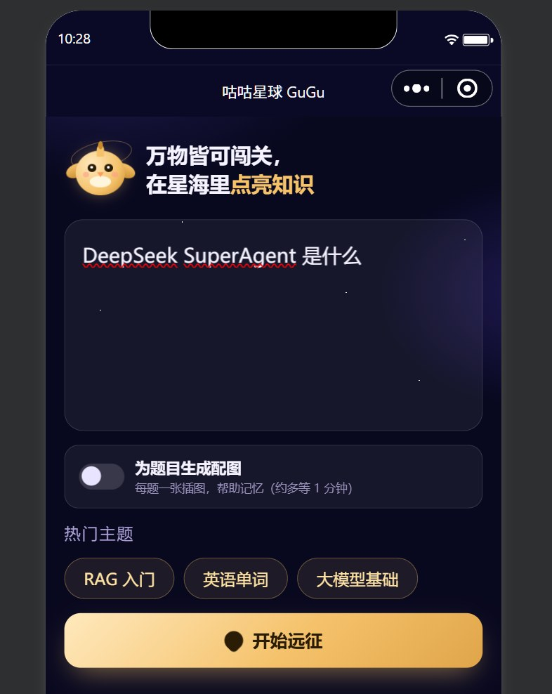
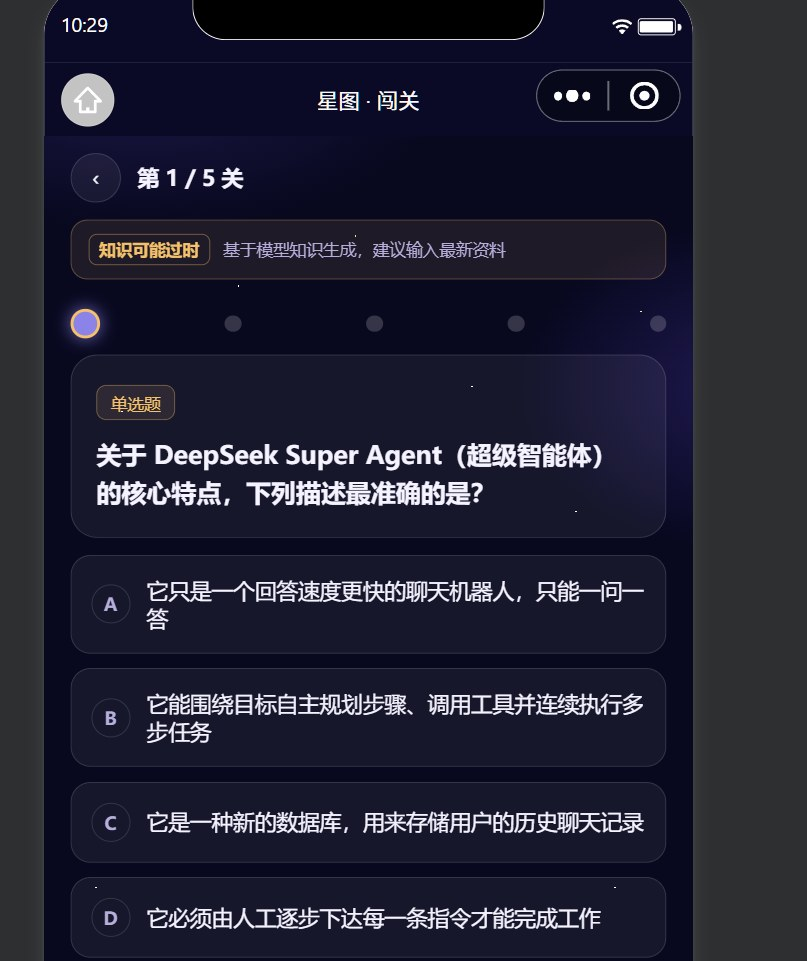
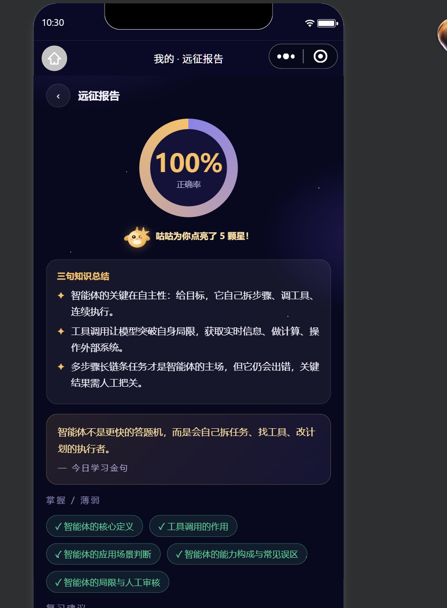
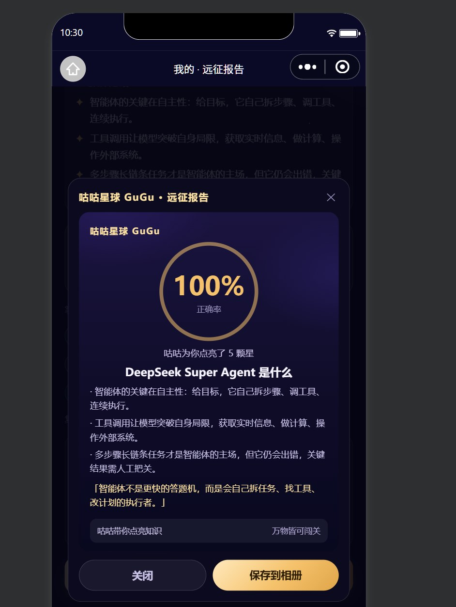
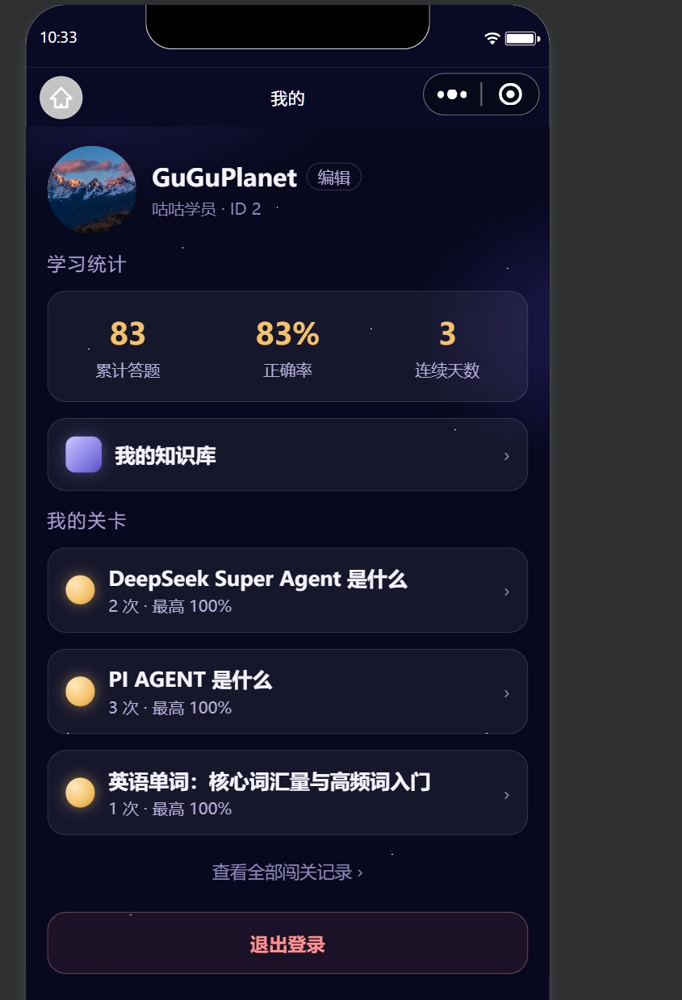
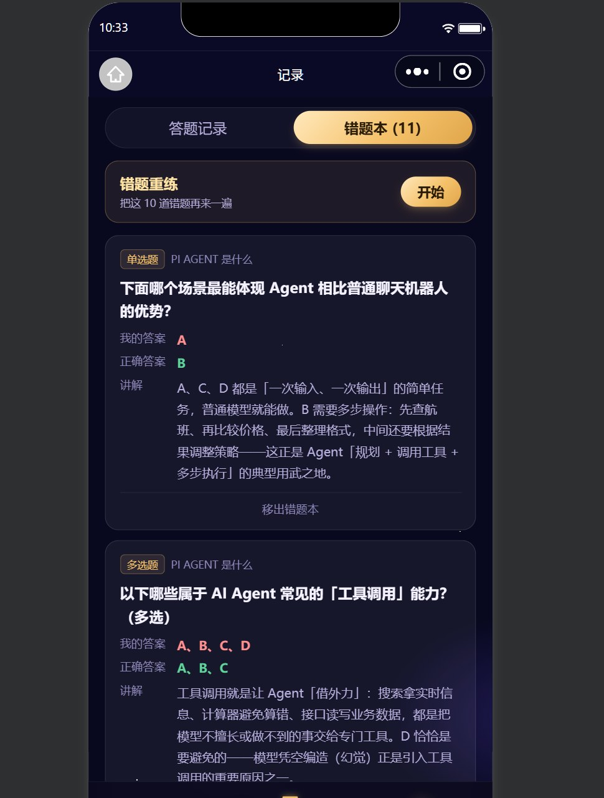

# AI 智能题库生成与知识问答系统（咕咕星球 GuGu）

> 产品名「咕咕星球 GuGu」· 独立全栈开发

AI 智能题库生成与知识问答系统是一个 AI 驱动的闯关学习小程序。用户输入任意知识主题，AI 会生成 5 道题（3 单选 + 1 多选 + 1 判断）组成一次「闯关」，答完即出复盘报告（正确率、三句总结、掌握/薄弱点、复习建议、金句）并生成可保存的分享海报。

除通用主题外，还支持上传 PDF / Word / 网页链接构建个人知识库，基于 RAG 向量检索出题；开启配图开关后，单选题会自动生成 AI 配图。答题数据沉淀为答题记录与错题本，支持错题重练与主题关卡进度。

技术上前后端分离：Taro 4 + React 18 一套代码同时输出微信小程序与 H5；FastAPI + SQLAlchemy + MySQL 提供接口，DeepSeek 负责出题与报告，qwen 系列模型负责 embedding 与生图，Chroma 做向量检索，图片存腾讯云 COS。后端 129 个测试用例覆盖核心链路。

## 界面预览

<table>
  <tr>
    <td align="center" width="33%"><br/><sub><b>首页 · 输入任意知识出题</b></sub></td>
    <td align="center" width="33%"><br/><sub><b>闯关答题 · 单选 / 多选 / 判断</b></sub></td>
    <td align="center" width="33%"><br/><sub><b>复盘报告 · 正确率与总结</b></sub></td>
  </tr>
  <tr>
    <td align="center" width="33%"><br/><sub><b>分享海报 · 可保存到相册</b></sub></td>
    <td align="center" width="33%"><br/><sub><b>我的 · 统计与主题关卡</b></sub></td>
    <td align="center" width="33%"><br/><sub><b>记录 · 错题本与重练</b></sub></td>
  </tr>
</table>

## 技术栈

| 层 | 技术 |
|---|---|
| 前端 | Taro 4.3.2 + React 18.2 + TypeScript + Sass（微信小程序 / H5 双端） |
| 后端 | FastAPI + SQLAlchemy 2 + MySQL 8 + PyJWT + LangChain |
| 出题 / 报告 | DeepSeek（`deepseek-flash`） |
| 知识库 | qwen3.7-text-embedding-flash + Chroma（SQLite 兜底） |
| 配图 / 海报 | qwen-image-3.0（千问），腾讯云 COS 存储 |
| 联网检索 | Tavily |

## 功能

- **AI 出题**：单选 / 多选 / 判断三类题型，3 题一组，支持联网检索最新资料
- **知识库出题**：上传 PDF / Word / txt / md 或网页链接，基于自己的文档出题（RAG，向量检索）
- **题目配图**：可选开关，单选/多选自动配图，两段式异步生成，每人每天 20 张额度
- **答题与复盘**：闯关页答题、逐题过关、AI 复盘报告（三句总结 / 掌握薄弱 / 建议 / 金句）
- **学习闭环**：答题记录、错题本、错题重练、主题关卡聚合
- **分享海报**：本地 canvas 合成，可保存到相册（不消耗生图额度）
- **用户体系**：微信小程序登录、头像昵称、学习统计、连续打卡

## 目录

```
backend/          FastAPI 服务
  app/{api,core,db,llm,models,prompts,services,utils}
  tests/          pytest（129 个用例）
frontend/         Taro 小程序 / H5
  src/pages/{index,quiz,report,records,profile,knowledge}
openspec/         规格驱动的变更记录
docs/screenshots/ 界面截图
原型图-核心流程.html
需求分析文档.md / 方案设计文档.md
```

## 本地运行

后端（需先启动 MySQL，并配置 `backend/.env`）：

```cmd
cd /d <项目目录>\backend
.venv\Scripts\python.exe -m uvicorn app.main:app --port 8000
```

前端小程序：

```cmd
cd /d <项目目录>\frontend
npm install
npm run dev:weapp
```

H5：

```cmd
cd /d <项目目录>\frontend
npm run dev:h5
```

测试：

```cmd
cd /d <项目目录>\backend
.venv\Scripts\python.exe -m pytest -q
```

## 环境变量

复制 `backend/.env.example` 为 `backend/.env` 后填入：DeepSeek、微信 AppID/Secret、MySQL、JWT、Tavily、embedding、生图、COS。
`.env` 已在 `.gitignore` 中，不会入库。

## 说明

- 微信登录仅小程序端；H5 仅作页面演示，不登录。
- 未部署上线，仅作学习与作品展示；小程序码、服务器域名未配置。
